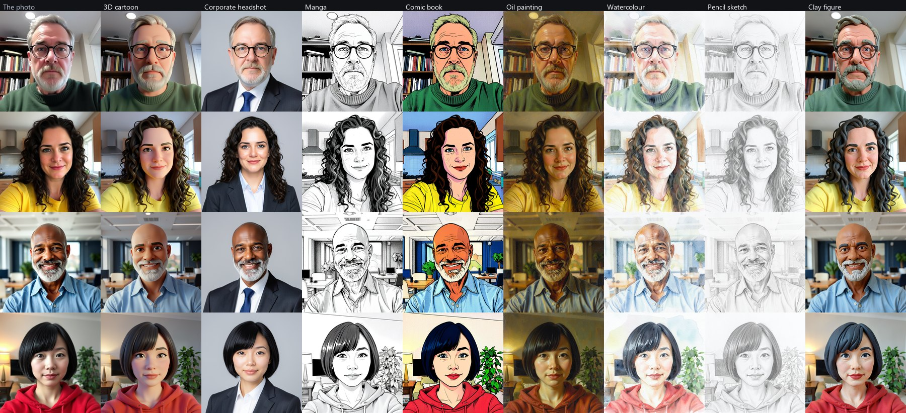

# Portrait Studio (experimental)

A photo of a person, drawn again in the style you pick: a 3D cartoon, a
corporate headshot, manga, a comic book, an oil painting, a watercolour, a
pencil sketch, a clay figure. It is still the same person -- that is the
point of the brick, and the hard part.



*The four photos on the left are of nobody: an image model drew them. The
brick was tried on these, not on photographs of real people (see "What was
not tried").*

## Using it

In the launcher, under **Images**: use the camera (three, two, one, and the
picture is taken), upload a photo, or pick one of the four bundled portraits;
then click a style. **Draw every style** goes through the ones not drawn yet
from that photo. Clicking a style again, or **Another take**, draws it once
more: another picture each time. A new photo puts the last one's portraits
away.

From a terminal:

```bash
uv run portrait-studio --image me.jpg --style manga --out manga.png
uv run portrait-studio --sample "Curls" --style all --out portraits/
uv run portrait-studio --list-styles
```

`--size` (512, 768, 1024), `--seed`, `--compute-device`, and `--model-path`
for a FLUX.2 klein OpenVINO build already on disk.

## The photo stays here

The camera is the browser's: the page takes the picture, cuts the square in
its middle and sends it to the launcher on this machine with each style
asked for. The launcher keeps it for the time of one drawing and writes
nothing to disk -- not the photo, not the portrait. Leaving the brick
switches the camera off. Nothing goes to a network.

There is no box to type a style into. A demo that photographs passers-by and
then draws whatever somebody types about them is not one to leave on a
stand; the eight styles are written in `styles.py`, and adding one is a line
there.

## The model

**FLUX.2 [klein] 4B** (Black Forest Labs, Apache-2.0), through
`openvino_genai.Image2ImagePipeline`, four steps a picture. For this model
"image to image" means the photo is given to the model whole, beside the
picture it is drawing, as something to look at -- not noise added to the
photo and cleaned up again.

That difference is the brick. The image model the Page Agent draws with,
FLUX.1-schnell, was tried first because it is already on disk (2026-10-11,
two portraits, four styles): up to a strength of 0.75 it hands the photo
back unchanged, at 0.9 it draws somebody else, and there is nothing in
between. The Page Agent has drawn with klein too since 2026-10-12: it is
also the faster and the lighter of the two at drawing from a description.

**Where it comes from.** Intel publishes no OpenVINO build of klein
(2026-10-12). The one used is `rupeshs/flux2-klein-4b-int4-ov` (4.6 GB,
Apache-2.0, made for the FastSD CPU program with the same exporter), held at
the one revision it was tried with: the repository is somebody else's, and
what is fetched is that state of it, not whatever it holds on the day
(`REVISION` in `pantherlake_ai_core/flux2_klein.py`, and the same in the
app's model inventory). It differs
from what the pipeline asks for in three small ways, none in the weights:
its text encoder gives one output where the pipeline asks for three layers
by name, its transformer takes its tokens' positions without a batch in
front, and its VAE's normalisation figures are in a file of their own.
`flux2_klein.prepare` writes a copy with those three changed, once, in 4 seconds,
under `~/.cache/pantherlake-ai-studio/models` (4.6 GB more: the two large
files are written again, the rest linked). A build made for the pipeline --
a recent optimum-intel export, or Intel's when there is one -- is used as it
stands.

## Measured

XPS 14 (Core Ultra X7 358H), OpenVINO 2026.3, 2026-10-12, 32 pictures on
each chip:

| Chip | Model loads in | 512 x 512 | 768 x 768 | 1024 x 1024 |
| --- | --- | --- | --- | --- |
| Integrated GPU (Arc B390) | 7 to 9 s | 3.2 to 3.3 s | 8 to 11 s | 14.5 to 17 s |
| Arc Pro B60 | 24 s | | 3.4 s | |
| NPU | does not run | | | |

On the integrated GPU a 768 picture is four steps of about 2 s (2.5 s once
the machine has warmed up), the rest reading the instruction and decoding;
its first picture after loading takes a few seconds more. One 768 picture
cost 139 to 332 J above idle there. The NPU's compiler does not take this
build: it ends the process after 44 s on OpenVINO 2026.4.1, and had not
finished after five minutes on 2026.3 -- the menu shows the NPU greyed out,
with why. OpenVINO 2026.4.1 draws the same pictures at the same pace.

The guidance setting changes nothing (the model is a distilled one), and
more than four steps were not tried: four is what it was made for.

## What the model is told, and what that taught

A style is an instruction about the photo in two halves: what to make of
it, and what to leave alone. The model draws every word it is given:

- "keep the same glasses and beard" put glasses and a beard on a woman who
  had neither; "the same facial hair" did it again;
- "the same dark or light skin colour" made a light-skinned woman dark;
- with none of that said, "a character from a family film" made a
  dark-skinned man light and took his beard off;
- a comic book came with speech bubbles of gibberish until it was told "no
  speech bubbles and no lettering"; "a frame from a stop-motion film" came
  in a wooden picture frame until it was "a still".

What held on all four portraits is to say that **only the rendering
changes** and that the person, their colours, their features and everything
else in the photo stay exactly as they are -- naming nothing a person may or
may not have. `tests/test_portrait_studio.py` holds the styles to that.

## What it does less well

- **Dark skin comes out a shade lighter** in the 3D cartoon, and orange in
  the comic book's flat colours. The wording above made it much better than
  it was, not right. The corporate headshot, the oil painting and the clay
  figure keep it.
- **The 3D cartoon is a mild one.** The more it is pushed towards a cartoon
  ("stylised rounded shapes", "big expressive eyes") the less it looks like
  the person, colours first.
- Black hair turns grey-blue in the clay figure; the corporate headshot
  invents the suit, and the tie with it.
- A picture is square: the middle of the photo. Somebody standing to one
  side of a wide webcam picture is cut.

## What was not tried

- **Photographs of real people.** Everything above is on four portraits an
  image model drew, and on the browser's stand-in camera (a test card). How
  well a real face is kept -- and whose is kept less well -- is the first
  thing to look at with the brick in hand.
- Two people in the photo, a face in profile, a hat, a photo taken in the
  dark, a child.
- The CPU (it should run, slowly), and a build at a finer precision than
  int4.
- The Page Agent's copy of the same model loaded beside this one on the same
  GPU: each brick loads its own (7.7 GB each).
