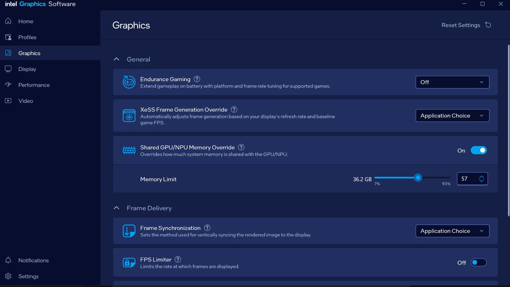

# Let the integrated GPU use more memory

The 30B coding model behind the Page Agent, Code Review and HTML Creator
runs on the integrated GPU, which borrows the laptop's memory. While it
writes a page it needs about 20 GB there: 15.1 GB once loaded and 15.9 GB at
the end of a 7,000-token answer, plus what the desktop and the browser
already hold on the GPU (measured on the XPS 14 on 2026-10-23).

Windows lets the integrated GPU use 57% of the memory unless told otherwise.

| Laptop | At 57% (default) | At 75% |
|---|---|---|
| 32 GB | 18 GB: too little | 24 GB: enough |
| 64 GB | 36 GB: enough | 48 GB: enough |

Until it is enough the Studio greys the model out and links to its own copy
of these steps, which also says what the laptop in front of you has
(`/static/gpu-memory.html` in the launcher). On a 32 GB laptop the setup
assistant (`first_launch.bat`) has a step of its own for it, just before the
last one.

## Change it

1. Open **Intel Graphics Software** (Windows key, type its name).
2. Click **Graphics** on the left.
3. Under **General**, turn on **Shared GPU/NPU Memory Override**.
4. Set **Memory Limit** to **75**: type it in the box, or drag the slider.
5. **Restart the laptop.** The limit applies only after a restart; until
   then the Studio says it was changed and keeps the model greyed out.

It is a ceiling, not a reservation: what the GPU does not use stays free for
Windows. At 75% a 32 GB laptop keeps at least 8 GB for everything else.

## Notes

- It needs an Intel Core Ultra of Series 2 or later and a recent Intel
  graphics driver (32.0.101.6974 or later). Older versions of the app call
  it "Shared GPU Memory Override".
- Intel says a limit under 50% is not saved. To undo it, turn the switch off
  or set 57, and restart.
- The Studio cannot change it itself: Intel's app is the only published way.
  It reads the value the slider writes,
  `HKLM\SYSTEM\CurrentControlSet\Control\GraphicsDrivers\MemoryManager\SystemPartitionCommitLimitPercentage`,
  and when that was written, to tell a change still waiting for a restart.
  (DXGI's shared-memory figure does not follow the slider: it said 75% on a
  laptop set to 57%.)
- To rehearse a 32 GB laptop on a bigger one: `PTL_MEMORY_GB=32` keeps this
  laptop's percentage; `PTL_GPU_SHARE_GB=18` sets the GPU's share directly.
